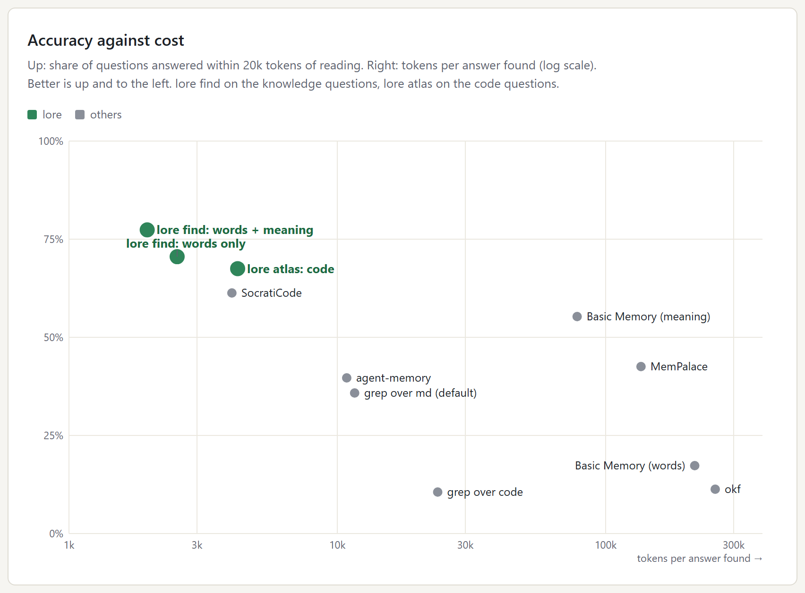

# CodeLore

**Project memory for coding agents, kept in your repo.** Faults met and their
fixes, measured readings, decisions, and plan items that never disappear
silently. JSONL in git, hybrid full-text + semantic search, one CLI - `lore` -
that checks and commits every entry.

> Status: **0.4.1** (0.4.0 was the rewrite in Rust). CodeLore is now one native binary,
> `lore`, with the same record format, commands and texts as the Python 0.3.0
> it replaces (its whole test suite is ported test for test in
> `tests/python_suite.rs`, and the embeddings are checked against the Python
> side's vectors in `tests/parity.rs`). The Python package is retired; its last
> version is the `v0.3.0-python` history on `main` before this change. The format
> is in [docs/FORMAT.md](docs/FORMAT.md), the design in [docs/DESIGN.md](docs/DESIGN.md).

## Install

```bash
git clone https://github.com/WhiteWh/CodeLore.git
cargo install --path CodeLore --locked      # puts `lore` on PATH (~/.cargo/bin)
lore --version                              # lore 0.4.1 (5fd9ae0); a `+` after the commit: built with uncommitted changes
```

**With Zerus.** Zerus builds its own `lore` from a pinned revision of this
repository and installs it beside `hgs` (`~/.local/bin/lore.exe` on Windows),
and hgs uses that copy first (`HGS_LORE`, else beside hgs, else PATH). Keep one
`lore` on the machine, or `where lore` / `which -a lore` lists two that both say
`lore 0.4.x` and the earlier one on PATH wins:

- **only Zerus's**: don't `cargo install` CodeLore; the pinned build is the one
  everything runs. It prints the version alone (`lore 0.4.1`) - a build made as
  another package's git dependency carries no commit, the pin names it.
- **a CodeLore build in the same place** (working on CodeLore itself): uninstall
  the cargo copy and install over Zerus's -
  `cargo uninstall codelore; cargo install --path CodeLore --locked --root ~/.local`.
  hgs then runs your build; the next Zerus install puts its pinned one back,
  and `lore --version` says which is there (`(sha)` yours, none Zerus's).

Then, at a repository's root:

```bash
lore init --areas build,render,deploy        # writes lore.toml and a .gitattributes line
git add lore.toml .gitattributes && git commit -m "lore init"
lore guide                                   # what an agent needs to know
```

## Measured

416 questions an agent asks in a real project - about faults, architecture,
plans and code, each asked exactly and as a paraphrase - put to `lore` and to
plain search and other memory tools for agents (SocratiCode, okf, agent-memory,
MemPalace, Basic Memory) over the same project's docs and source:



| | answer within 20k tokens | answer first | tokens per answer found | query, exact / paraphrase |
|---|---|---|---|---|
| **`lore find`** (knowledge questions) | **77%** | **53%** | **~2 000** | 0.31 s / 0.31 s (0.08 s words only) |
| **`lore atlas`** (code questions) | **68%** | **46%** | **~4 300** | 0.16 s / 0.18 s |
| SocratiCode | 61% | 27% | ~4 000 | 0.06 s / 0.06 s |
| grep over the docs | 36% | 19% | ~11 600 | 0.10 s / 0.05 s |
| okf (whole documents) | 11% | 51% | ~256 000 | 1.4 s / 1.4 s |

What each number means, how it was measured, every chart and the limits:
[docs/BENCHMARK.md](docs/BENCHMARK.md).

## The problem it solves

A project worked on by agents accumulates knowledge fast and loses it just as
fast. What it looks like after a few months:

- a troubleshooting page of 1 500 table rows and 1.4 MB, each row a story,
  found by grep when the exact error string is known and missed otherwise;
- a verification page of 29 000 lines that only ever grew, with plans and
  post-mortems filed under unrelated headings;
- hundreds of hand-back reports written once and read never;
- plans of which part was done, part silently abandoned, and nothing says which;
- agent instruction files that keep growing because there is nowhere else to
  put what was learned.

All of these numbers are from one real repository. The cause is the same in
every case: knowledge is written as **prose in shared documents**, appended to
and never retired, with no unit smaller than a file and no rule for what an
entry must say.

## What CodeLore does instead

- **Knowledge is records, not prose.** A fault is *symptom, the exact strings
  it shows, cause, fix, and the check that sees it* - a few lines, not a page.
  A reading is *what is measured, by which command, the value, at which commit*.
  A decision is *the question, the choice, the reason, who decided*. A topic
  is *how something works now*, a page-sized piece; a recipe is *when, the
  steps, and how to see it worked*. A source records what became of a document
  moved in: which records hold each of its parts, which were skipped and why.
- **Plans are records too.** A plan has a goal and items; an item ends **done**
  (with its commits), **dropped** (with a reason and who decided),
  **superseded** or **deferred** - never just forgotten. A plan cannot close
  while an item is open, and `lore stale` lists what nobody has touched.
- **The records live in your repository**, as a few JSONL files - one record a
  line, sorted, readable in a diff, cloned with the project. No server, no
  account, no database to sync.
- **One CLI writes them, and it is strict.** Required fields, length limits that
  keep a record a record, references checked against `HEAD`, and a duplicate
  search before every new entry. `lore` commits its own change, so an agent
  never stages a shared file by hand.
- **Search is hybrid.** SQLite FTS5 for exact strings - an error message, a code,
  a symbol - and embeddings for "something like this", merged by reciprocal rank
  fusion. Embeddings are optional and local: built in
  (`provider = "builtin"`: nomic-embed-text-v1.5, bge-m3 or multilingual-e5-base
  run in-process on candle; `provider = "ollama"` in an older lore.toml means
  the same built-in model). The `lore` binary fetches the model itself the first
  time it is needed - `lore init` starts it in the background, `lore index`
  waits for it - pinned by size and SHA-256; `LORE_MODEL_FETCH=off` stops that.
  Without a model, `lore` searches text and says so.
- **The index is disposable.** It is built from the JSONL into your user cache
  and never committed.

## A taste of it

```bash
lore find "tar: Damaged tar archive (bad header checksum)"
lore find - < traceback.txt          # paste an error, get the records that know it
lore find "push rejected" --stores all   # a store and its sub-stores (teams/...), each result marked
lore for src/render/post/chain.py    # what is known about this file before you edit it

lore add fault --json < record.json  # validated, de-duplicated, committed
lore plans                           # live plans: open / done / dropped
lore stale --days 14                 # open items nobody touched
lore item drop api-v2#4 --reason "the v1 endpoint is enough for now"
lore plan close api-v2 --outcome "..."
lore check                           # the gate: schema, refs, dependency cycles
lore cover docs/old-handbook.md      # moving docs in: which parts no record or skip accounts for
```

## For agents

`lore guide` prints the instructions an agent needs - how to search, how to
record, how to work a plan. A project's `AGENTS.md` / `CLAUDE.md` then needs one
line instead of a growing essay:

```markdown
Project knowledge and plans are in CodeLore: run `lore guide` once per session.
```

## Orchestrators

CodeLore is the durable half of planning, not a task runner. A multi-agent
orchestrator (an agent-teams runner, say) plans and executes; it writes the
plan, its items and how each closed into the project's lore through the same
CLI (`--json` in and out). Who is working on what *right now* is the
orchestrator's runtime state and stays there. CodeLore knows nothing about any
orchestrator; without one, a person or a single agent keeps the same records by
hand.

## Atlas: the code map (experimental)

In every build and switched on per project with `[atlas] enabled = true` (or
`LORE_ATLAS=on`), `lore atlas` adds the other half: where things are
in the code now. Pieces of every file searchable by words, whole terms, symbol
names and meaning, the import graph, and where it meets the records -
`lore atlas impact <file>` lists every file a change reaches *and what the lore
knows about each*; `lore atlas drift` the records citing code that is gone. One
binary, no server, no watcher. Design and switches: [docs/ATLAS.md](docs/ATLAS.md).

## What it is not

Not a tracker: no assignees, no notifications, no board. Not a server. Not a
transcript or chat memory. Not a replacement for code search - it indexes what
was *learned*, not the source.

## Requirements

Rust 1.99+ to build, git at run time. SQLite (with FTS5) is bundled. The
built-in embedding model (about 0.5-2 GB in the user cache) is fetched on first
use, or ahead of time with `lore model fetch [--model bge-m3|e5-base|nomic]`,
into one folder every `lore` on the account shares (`%LOCALAPPDATA%\codelore\models`,
`~/.cache/codelore/models`; `LORE_MODELS` names another, a machine-wide one say) -
not per `LORE_CACHE`, so several installs fetch a model once.

**GPU.** `cargo install --path CodeLore --locked --features directml` runs the
embeddings on any DirectX 12 GPU on Windows - AMD, Intel or NVIDIA - through
ONNX Runtime's DirectML provider; the model's ONNX export and a pinned
DirectML.dll are fetched beside the weights. Where no GPU answers, the same
binary runs on the CPU (`LORE_DEVICE=cpu` forces that); `lore model status`
says which. It needs the Visual C++ runtime (MSVCP140.dll), which most Windows
machines have. A GPU batch holds at most 4 096 padded tokens, so long code pieces
go a few at a time and short records many (`LORE_EMBED_TOKENS` changes it); on an
8 GB laptop card that is ~900 code pieces a minute, seven times the speed of
fixed batches of 32. A search embeds its one query on the CPU, and the first
search starts `lore model serve`: the model held in memory on 127.0.0.1 (a
token in its state file), so the searches after it open no model of their own
(~0.3 s with meaning instead of ~0.8). It ends after ten idle minutes;
`LORE_EMBED_SERVE=off` turns it off.

**Code map.** Every build has `lore atlas` (docs/ATLAS.md); a project turns it on
with `[atlas] enabled = true`. `--no-default-features` builds without it.

## Development

```bash
cargo test --locked
```

The tests build scratch git repositories; they need git and nothing else. The
embedding parity test runs when a model is installed and skips with a note
otherwise. Search measurements of this version: [docs/RESULTS-rust.md](docs/RESULTS-rust.md).

## License

MIT - see [LICENSE](LICENSE).
