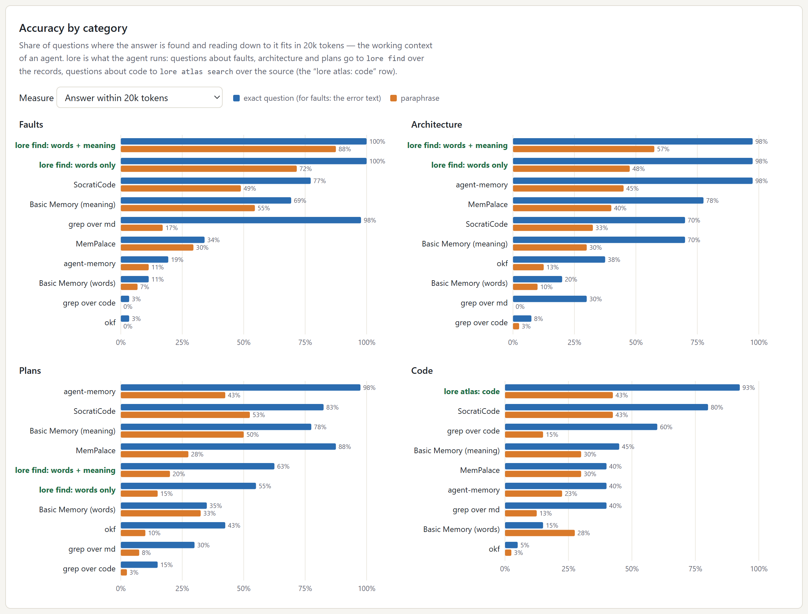
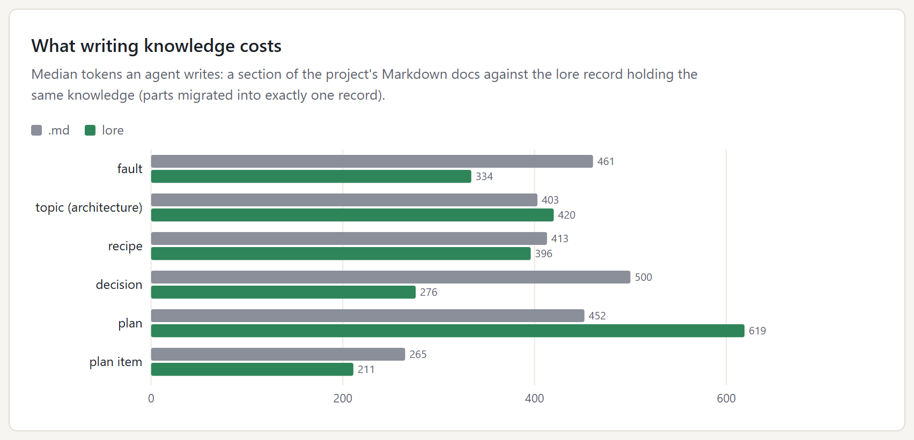
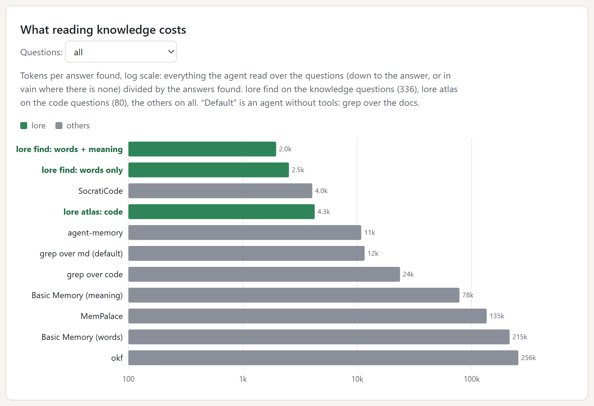
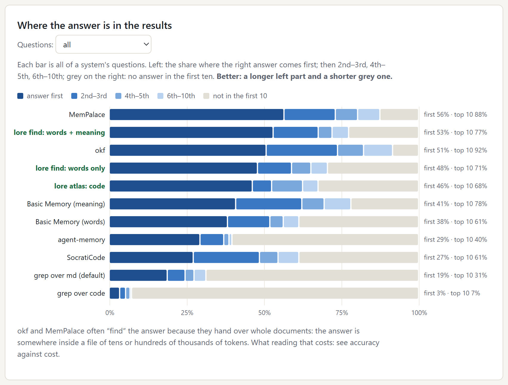
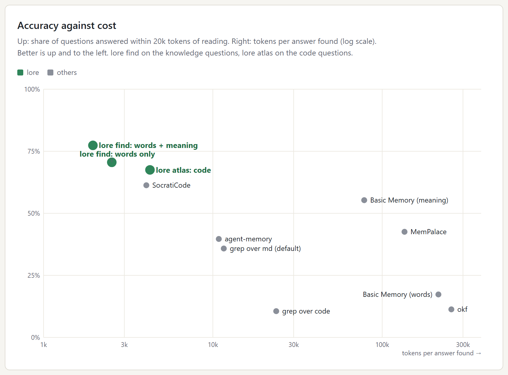
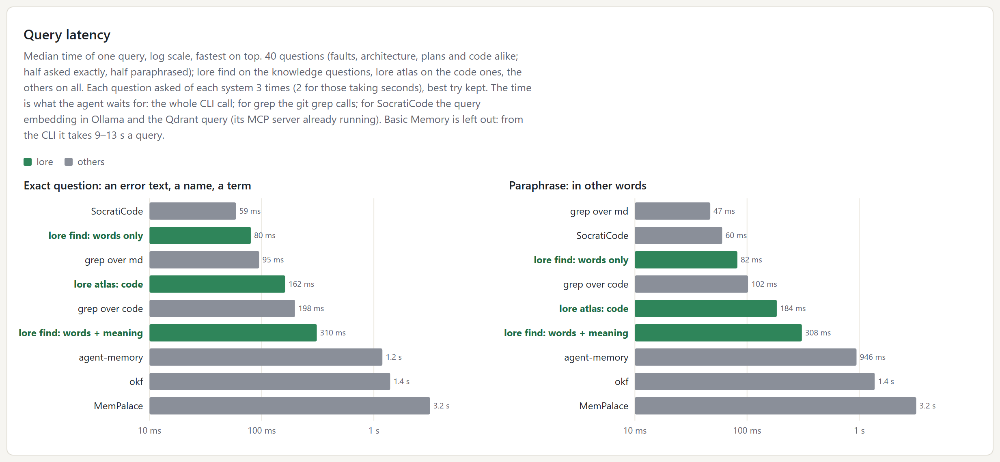

# CodeLore benchmark

What an agent gets when it looks something up in a real project - through
`lore`, through plain search, and through other memory tools for agents - and
what that costs it: in answers found, in tokens read, in time.

## Why this exists

An agent working in a project keeps needing the same kinds of knowledge: why a
build breaks with *this* error, how a subsystem is put together, what was
decided, what is still planned, where something lives in the code. Without a
memory it greps the docs and the source, opens whole files, and pays for every
line in its context window. CodeLore keeps that knowledge as checked records in
the repository and answers with the record, not the file. This benchmark checks
whether that pays off, and against what.

## How lore answers

The agent runs one command - `lore find "<question or error text>"` - and lore
picks the way itself:

1. **Text first.** SQLite FTS5 over words, whole terms and exact error lines. When
   the question is an error, a path, a function name or a code, or a record holds
   the exact string, the answer goes back at once (~0.1 s), without the model.
2. **Otherwise meaning too.** The built-in embedding model (nomic-embed-text, no
   Ollama, no cloud) finds records by meaning; the two lists are fused by rank.
   The model stays in memory in a background `lore model serve`, so such a search
   is ~0.3 s.
3. **Code** has its own map, Atlas: pieces of files, symbols, imports.
   `lore atlas search` searches it, `lore for <file>` says what the lore knows
   about a file and who imports it; with `[atlas] find = true` in lore.toml,
   `lore find` adds code places to its results itself.

The labels below: **lore find: words + meaning** is plain `lore find` with this
routing; **lore find: words only** is the same search with `--text-only`, for
comparison; **lore atlas: code** is the code map's search.

## Setup

- **Project.** A private working repository several agent sessions work in at
  once: 575 Markdown files of documentation (20 MB) and 4 524 source files at the
  commit before CodeLore came in; its lore after the docs moved in: 6 773 records.
- **Questions.** 416, the kind an agent asks at work. Faults: 88 rows of the
  project's troubleshooting page. Architecture, plans, code: 40 parts each of the
  docs and the source. Every question is asked two ways - **exact** (the error
  text, a name, a term) and a **paraphrase** that shares no three-word run with
  the source and none of the answer's keys.
- **Who searched what.** The other tools indexed the documentation and the source
  *as they were before CodeLore*, each its own usual way with default settings.
  `lore find` searched the lore's records; `lore atlas` the same source.
- **An answer** is a result that holds the fix string or the function name of the
  question's keys - one rule for every system. When the answer sits in a document
  behind a snippet, the agent reads the whole document, and the tokens count it.
- **Tokens** are bytes / 4 of everything the agent read down to the answer (all
  of it, on a miss).

Compared:

| system | how it searches | model |
|---|---|---|
| grep over md / over code | `git grep` as an agent's Grep tool: the exact text, else the two rarest words | - |
| [SocratiCode](https://github.com/giancarloerra/socraticode) 1.13.3 | Qdrant, BM25 + dense vectors fused by rank, over file chunks | nomic-embed-text via Ollama |
| [okf](https://github.com/okf-memory/okf-agent-memory) 0.8.0 | in-memory BM25 over Markdown concepts, recomputed per search | - |
| [agent-memory](https://github.com/xChuCx/agent-memory) 0.6.1 | SQLite FTS5 over Markdown sections, a budgeted bundle back | - |
| [MemPalace](https://pypi.org/project/mempalace/) 3.11.0 | ChromaDB vectors over chunks plus BM25 | all-MiniLM-L6-v2 |
| [Basic Memory](https://github.com/basicmachines-co/basic-memory) 1.0.0 | SQLite FTS over notes (“words”) or vectors (“meaning”) | bge-small-en-v1.5 (FastEmbed) |

projectmem was looked at too; it cannot take documents and is not in the tables.

## Method

**The questions.**
- *Faults* (88): the rows of the project's troubleshooting page. The exact
  question is the error text the fault prints, as an agent would paste it; the
  paraphrase describes the symptom in other words; the keys are strings of the
  fix.
- *Architecture, plans, code* (40 each): a seeded random sample of documentation
  parts that moved into exactly one lore record (topics for architecture, plans
  and plan items for plans) and of functions in the source. For each, a source
  excerpt and its **keys**: distinctive strings - a name, a path, a value - found
  in the excerpt and, for docs, in the record it became, and common nowhere else
  in the corpus. An agent model wrote one exact question and one paraphrase per
  excerpt from the excerpt alone.
- *Fairness checks*, run on every question: no key appears in the question
  itself, and a paraphrase shares no run of three words with its excerpt - so it
  cannot be found by copying text from the source.

**Asking.** Every system got every question once, as its user would ask it, and
gave at most 10 results:

| system | the call | one result, as the agent reads it |
|---|---|---|
| `lore find` | `lore find "<q>" -n 10` (`--text-only` for "words only") | the record as printed, with its confidence line |
| `lore atlas` | `lore atlas search "<q>" -n 10 --text-only` | the code piece: path, lines, symbols, text |
| grep | `git grep -n -i -F "<q>"`; with no hit (and always for a paraphrase) the rarest word of the question as a whole word, the lines that also hold the second rarest when there are such | the matched line with two lines either side; up to 250 |
| SocratiCode | its query: the question embedded with `search_query:`, BM25 and dense lists fused by rank in Qdrant | the chunk |
| okf, agent-memory, MemPalace, Basic Memory | their search command with 10 results | what the command prints for one hit |

**Scoring.** Reading goes down the results in order. A result *answers* when its
text holds one of the question's keys (an exact, case-sensitive substring - the
same rule for every system). If the shown snippet does not hold a key but the
document behind it does, the agent opens that document: the answer is at that
rank and the whole document is read. Nothing found in the results is a miss, and
everything shown was read in vain.

**Latency** was taken separately: 40 of the questions (10 per category, half
exact, half paraphrased), each asked of each system three times (twice for those
taking seconds), systems in shuffled order every pass, best try kept. The time is
wall clock of the call an agent makes; lore's model server was up, as it is after
an agent's first search.

**Index builds** are wall clock from an empty cache, one build at a time.
**Write cost** compares, for parts that moved into exactly one record, the
Markdown section's size with the record's (bytes / 4).

## What the values mean

| value | meaning |
|---|---|
| answer first | share of questions whose first result answers |
| top 3 / top 5 / top 10 | share where an answering result is among the first 3 / 5 / 10 |
| answer within 20k tokens | found, and reading down to it (whole documents included) is at most 20 000 tokens - what fits in an agent's working context |
| tokens to the answer | bytes / 4 of everything read down to the answer, or of all results on a miss; the median over the questions |
| tokens per answer found | all tokens read over the questions, divided by the number of answers found: what one useful answer costs, misses included |
| exact / paraphrase | the question as an error text, name or term / the same question in other words |
| latency | median over the questions of each one's best try, in milliseconds |
| light load / under load | measured with only background processes running / during other builds on the machine |

## Accuracy by category

Share of questions where the answer is found **and** reading down to it fits
in 20k tokens - the room an agent has to work in. Blue is the exact question,
orange the paraphrase; best systems on top. lore leads on faults and
architecture and, through Atlas, on code (93% of exact code questions against
80% for SocratiCode and 60% for grep over the code). Plans are lore's weak spot:
`lore find` hides closed plans by default, and most of the plans asked about here
are closed.

## What writing and reading knowledge cost

Writing: the median tokens an agent writes for one piece of knowledge - a
Markdown section against the lore record that holds the same thing. About the
same overall: a fault (334 against 461) and a decision (276 against 500) are
cheaper as records, a plan dearer (619 against 452).

Reading: everything the agent read over the questions - down to the answer, or
in vain - divided by the answers it found. This counts the misses too, so a tool
that finds little and reads little does not look cheap. `lore find` costs ~2k
tokens per answer, grep over the docs (an agent without tools) ~12k, the tools
that hand over whole documents 78k-256k.

## Where the answer is, and at what cost

Each bar is all of a system's questions: on the left the share where the right
answer comes first, then 2nd-3rd, 4th-5th, 6th-10th, and grey where it is not in
the first ten. Better is a longer left part and a shorter grey one. okf and
MemPalace rank high here because they return whole documents - the answer is
somewhere inside a file of tens or hundreds of thousands of tokens. The next
chart shows what that costs.

Up: questions answered within 20k tokens of reading. Right: tokens per answer
found, log scale. Better is up and to the left - where the three lore points
are: `lore find` answers 77% of the knowledge questions within budget at ~2k
tokens an answer, `lore atlas` 68% of the code questions at ~4k; SocratiCode
61% at ~4k, grep over the docs 36% at ~12k.

## Query latency

Median time of one query as the agent waits for it: the whole CLI call (for
SocratiCode the embedding in Ollama and the Qdrant query, its server already up).
Each question was asked of each system three times (twice for those taking
seconds) in shuffled order, and the best try kept, so a virus scan of a new
process does not land on one system. On exact questions lore is faster than
grep - `lore find` 80 ms against 95 ms over the docs, `lore atlas` 162 ms against
198 ms over the code. On paraphrases grep is faster: it searches two rare words
and mostly finds nothing. With the model, `lore find` takes ~0.3 s - 3-10 times
less than agent-memory, okf and MemPalace; SocratiCode answers in ~60 ms
because its server and Ollama are always running. Basic Memory is left
out: from its CLI it takes 9-13 s a query.

## Index builds and writes

From an empty cache, one at a time. "Light load": no builds beside it, only
background processes; "under load": the first run, during other builds on the
machine.

| what | system | data | light load | under load |
|---|---|---|---|---|
| full index | lore, text | 6 773 records | 2.0 s | - |
| full index | lore, text + vectors on the GPU (DirectML) | 6 773 records | 182 s | - |
| full index | lore Atlas, text | 4 524 files, 39 698 pieces | 69 s | 76 s |
| embeddings | lore Atlas, vectors on the GPU | 31 723 pieces | 24 min | - |
| full index | agent-memory | 575 md, 20 MB | - | 10 min |
| full index | MemPalace | 575 md, 20 MB | - | 29 min |
| full index | SocratiCode | 5 230 files, 33 696 chunks | - | 36 min |
| full index | okf | 575 md | no index: BM25 per search | |
| one write | `lore add` | into 6 773 records: checks, duplicates, commit | 1.65 s | 6.5 s |
| first find of it | `lore find` | after `lore add`, index refreshed | 0.98 s | 1.9 s |

## What this does not show

- One project. The numbers are this project's; the method carries over.
- A working machine, not an idle one: timings vary by tens of milliseconds.
- Latency on code questions rests on 5 exact and 5 paraphrased questions.
- Atlas was measured on text alone; its meaning search was not.
- Migrating existing docs into lore is work up front: ~4.6M tokens read and ~2.1M
  written for this project. A new project starts with lore and pays nothing.

An earlier, narrower run (faults only, lore against grep) and its method:
[RESULTS-rust.md](RESULTS-rust.md).
